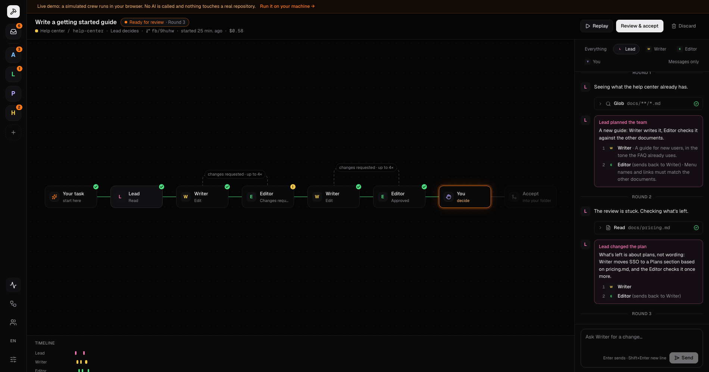
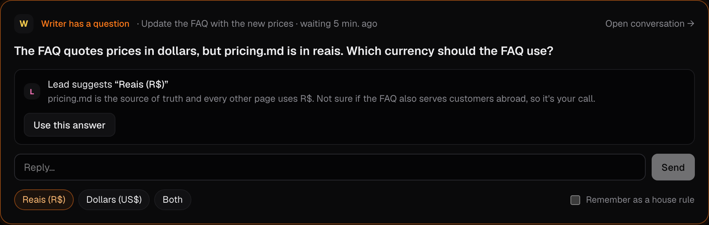
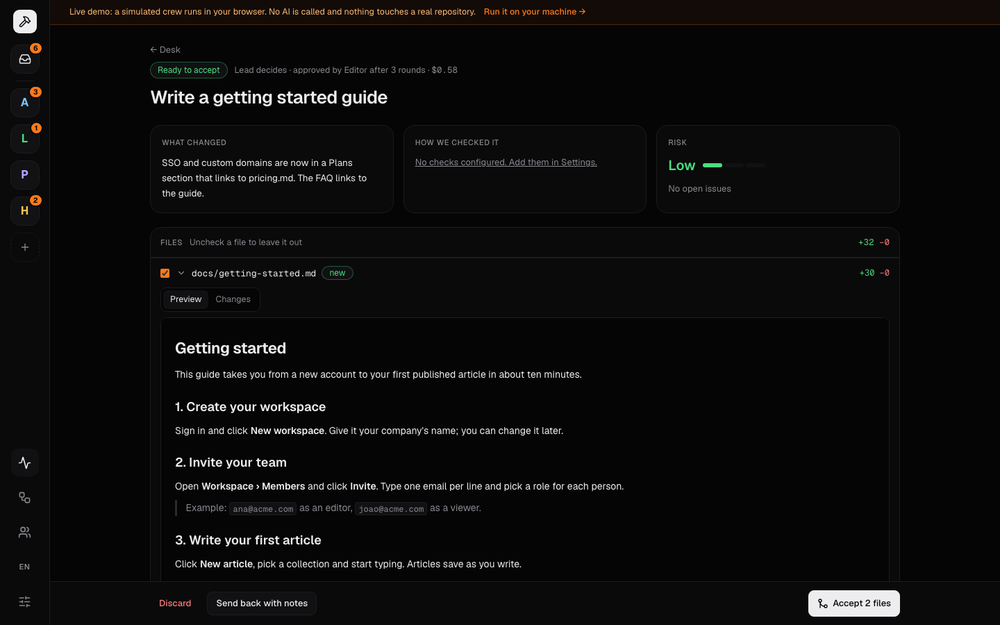
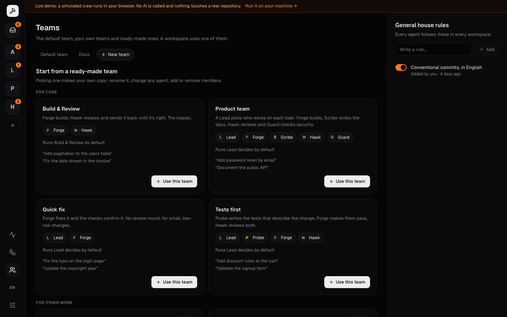

# Forgeboard

**Your crew of AI agents, on your machine.** Describe a task; Forge builds it, the checks run, Hawk reviews it and sends it back until it's right. Agents ask you when they need a decision. You merge when you're happy. Need a different process? Build your own flow, with your own agents. Not code? Teams for docs, content, research, data and translation work in any folder.


<sub>The demo above runs in the browser with a simulated crew (`pnpm demo`). See [Live demo](#live-demo).</sub>

> Status: **v2.5**. Lead checkpoints (a stuck review, a builder's question, your note at a pause), any kind of work (docs, content, research, data, translation) in any folder, teams (your own or ready-made), a Lead that picks the team for each task, your own flows (builders, reviewers, checks, "Ask me" pauses) and your own agents, a flow per task, a conversation with the crew (message it mid-run, "decide and tell me" mode), Claude Code and Codex as providers, install with `npx forgeboard`, agents ask with forms and editable plans (A2UI), public demo mode, workspaces per project, live run view, merge decision, house rules, English (US) and Brazilian Portuguese. Next up: drag-and-drop canvas and parallel steps (see `docs/plans/v3-teams.md`).

## How it works

Every task runs a **flow**. The built-in one, **Build & Review**:

```
your task → Forge (builds) → Checks (tests · lint · types) → Hawk (reviews)
                 ↑                                              │
                 └──────── changes requested (up to N rounds) ──┘
                                                                ↓
                                              You: merge · send back · discard
```

- **Make your own flows** in **Flows**, as a list of steps with a live preview. There are four kinds of step:
  - **agents that build** (edit files);
  - **agents that review** (read only, and send work back to a builder up to N rounds);
  - **checks**;
  - **Ask me** pauses: you continue, or write a note that goes back to the builder before it.

  For example: *Forge → Checks → Hawk ↩ Forge → Scribe (docs) → Ask me*. Pick the flow in the task bar; each workspace has a default.
- **Or let the Lead decide.** With the **Lead decides** flow, the Lead reads each task and picks who builds, whether the checks run and who reviews, with a line on why for each step. You approve the plan or ask for another one (or, in *Decide and tell me*, it just runs). The Lead also steps in mid-task: when a review is still stuck after its last round (one more round, new steps or hand it to you), when a builder asks something it can answer (it answers in *Decide and tell me* when sure, or suggests an answer), and when you send it your note at a pause.
- **Use a team.** In **Teams**, start from a ready-made team (Product team with a Lead, Scribe and Guard; Quick fix; Tests first) or build your own, then pick it for a workspace. Its agents, Lead and default flow come with it.
- **Not only code.** Teams for **Docs**, **Content**, **Research brief**, **Data analysis** and **Translation** work in any folder: "Choose folder…" can start tracking a plain folder in one click. Each team says what it works on, so agents are told the right thing, its builders can be limited to editing files, and the review screen shows changed documents rendered, with an **Accept** button.
- **Make your own agents** in **Teams**. Each gets a name, a role (builds or reviews), the AI that runs it (Claude Code or Codex), a personality and instructions. What an agent may do follows from its role.

- **Every task runs in its own git worktree** (`~/.forgeboard/worktrees/<task>`), on a branch like `fb/add-pagination-ab12c`. Your checkout is never touched until you merge.
- **Checks are objective.** Forgeboard runs your repo's own commands (detected from `package.json`, editable in Settings) wherever the flow has a checks step. A reviewer can't approve while a check fails.
- **You talk to the crew.** Each run is a conversation: reply to questions by typing, or message the builder while it works and it picks your message up right away (same session). Prefer fewer interruptions? In **Decide and tell me** mode, builders go with their best guess and list what they decided for you to check.
- **Rich questions.** When several decisions are needed, Forge asks with a small form; for bigger tasks it proposes a plan you can edit before anything is built. Forms use [A2UI](https://a2ui.org/) with a fixed catalog of Forgeboard components, validated on the server and in the browser.
- **The crew learns.** Answers can be saved as **house rules**, and Hawk suggests rules from what it sees in reviews. Every agent follows them on every task.
- **One workspace per project.** Group a project's repositories in a workspace with its own crew and house rules (general → workspace → repository). The "All" desk shows what needs you across every workspace.
- **You stay in charge.** The merge screen leads with what changed, how we know it works and the risk; then the diff, where you can leave files out.


| Question with a form | Editable plan |
| --- | --- |
|  |  |


### Teams and the Lead



| The Lead suggests an answer | A document, rendered, ready to accept |
| --- | --- |
|  |  |



## Live demo

The web app has a **demo mode**: a simulated crew runs entirely in the browser, with four workspaces and tasks in every state, including a help center run by the **Docs** team, where the Lead plans each task, steps in when a review gets stuck and suggests answers to the Writer's questions. Visitors can answer the agents' questions, watch the run, review the diff (documents show rendered), merge or accept, replay finished runs and start new tasks. No server, no AI and no real repository involved.

Run it locally:

```bash
pnpm demo
```

Publish it on Vercel:

1. Import the repository at [vercel.com/new](https://vercel.com/new).
2. Set **Root Directory** to `apps/web` (Vercel installs the pnpm workspace from the root).
3. Add the environment variable `NEXT_PUBLIC_FORGEBOARD_DEMO=1`.
4. Deploy.

## Getting started

Requirements: **Node 22.13+**, **git**, and at least one agent CLI logged in: [Claude Code](https://docs.claude.com/en/docs/claude-code) (Claude subscription or API key) and/or the [Codex CLI](https://github.com/openai/codex) (ChatGPT account or OpenAI API key). Forgeboard never sees your keys. Pick the provider of each agent in **Crew**, e.g. Claude builds and Codex reviews.

```bash
npx forgeboard
```

That's it: it opens http://localhost:4317. Create a workspace, pick one or more folders with "Choose folder…" (a git repository, or any folder: click "Start tracking this folder"), and type a task in the top bar. To keep it installed: `npm i -g forgeboard`, then run `forgeboard`.

| Option | Default | |
|---|---|---|
| `-p, --port <port>` | `4317` | Port to serve on (loopback only) |
| `--data-dir <dir>` | `~/.forgeboard` | Tasks, settings and worktrees |
| `--no-open` | | Don't open the browser |

### From source

To work on Forgeboard itself (needs pnpm):

```bash
git clone https://github.com/vitorhaoliveira/Forgeboard.git
cd Forgeboard
pnpm install
pnpm dev
```

The API runs on :4317 and the web app on http://localhost:3000, with hot reload.

**Try it without spending tokens:** in **Crew** (the default crew), set both agents to **Mock (no AI)**. The scripted crew asks a question, gets a review rejected, fixes it and gets approved — with real file changes, so merging works too.

### What agents may do

What an agent may do follows from its role, not its name:

| Role | Files | Commands |
|---|---|---|
| **Builds** (e.g. Forge) | edits files in the task's worktree | package managers (`npm`, `pnpm`, `yarn`, `bun`, `npx`, `node`) and read-only git/`ls`; anything else is refused |
| **Reviews** (e.g. Hawk) | read only | none (Claude Code runs it without shell or edit tools); it gets the check results from Forgeboard |

Agents never commit, push or touch your branch. Merging is always your click.

With **Codex**, its own sandbox does the isolation: reviewers run read-only, and builders can only write inside the task's worktree (with network in Standard, without it in Restricted).

**Standard** (the default) lets Forge run package managers and `node`, which in practice can run any code on your machine. For repositories you don't fully trust, switch the workspace to **Restricted** (workspace settings → Safety): Forge then only edits files and Forgeboard runs the checks. The API is local-only and, with `forgeboard`, needs an access key printed as a link in the terminal. See [SECURITY.md](SECURITY.md) for what is and isn't protected.

### Languages

The UI follows your browser language on first visit (English or Português) and can be switched with the **EN / PT** button in the sidebar. Agents write their messages in the same language as the UI.

### Configuration

| Variable | Default |
|---|---|
| `FORGEBOARD_PORT` | `4317` |
| `FORGEBOARD_DATA_DIR` | `~/.forgeboard` |
| `FORGEBOARD_WEB_ORIGINS` | `http://localhost:3000,http://127.0.0.1:3000` |
| `FORGEBOARD_CLAUDE_BIN` | `claude` |
| `FORGEBOARD_CODEX_BIN` | `codex` |
| `FORGEBOARD_CHECK_TIMEOUT_MS` | `300000` |
| `NEXT_PUBLIC_FORGEBOARD_API` | `http://127.0.0.1:4317` |

## Project structure

```
apps/
  server/   Local API (Hono + SQLite): orchestrator, git worktrees, checks, providers, SSE
  web/      Next.js UI (next-intl, Tailwind): All desk, workspace desk and settings, Run, Decide, Crew, Settings
packages/
  cli/      The `forgeboard` npm package: one command that serves the API and the web app on one port
  shared/   Types shared by server and web (Task, RunEvent, Verdict…) and the A2UI form catalog
```

### Releasing

1. Bump `version` in `packages/cli/package.json` and add the section to `CHANGELOG.md`.
2. Merge to `main`, then tag: `git tag v2.5.1 && git push origin v2.5.1`.
3. The **Publish to npm** workflow checks the tag matches the version, builds the package and publishes it with npm Trusted Publishing (no token; set up once on npmjs.com under the package's Settings → Trusted Publisher). It then creates the GitHub release, with the version's `CHANGELOG.md` section as notes; the title comes from the section's first line ("Talk to the crew: …" → "v1.9.0 — Talk to the crew").

The very first version was published by hand (`pnpm package`, then `npm publish --access public` in `packages/cli`), since npm only lets you add a trusted publisher to a package that already exists.

To try the package locally: `pnpm package`, then `npm pack` in `packages/cli` and install the `.tgz` anywhere.

Key server files: `orchestrator.ts` (`runFlow`, which runs a task's flow step by step), `prompts.ts` (what each agent is told and how its answer is parsed), `git.ts` (worktrees, diff, merge), `checks.ts`. Flows and their validation (`BUILD_AND_REVIEW`, `validateFlow`) live in `packages/shared`.

## Roadmap

- [x] **v0 — Foundation**: run a task, live stream, cancel, history
- [x] **v1 — Crew & review**: Build & Review loop, worktrees, checks, agent questions, merge decision, house rules, EN/PT
- [x] **v1.1 — Workspaces**: projects with their own repos, crew and rules; "All" desk
- [x] **v1.5 — Public demo**: simulated crew in the browser, replay of finished runs
- [x] **v1.6 — Rich questions (A2UI)**: agents ask with small forms and editable plans
- [x] **v1.7 — One-command install**: `npx forgeboard`, published to npm from a version tag
- [x] **v1.8 — Codex**: OpenAI's Codex CLI as a provider for any agent, sandboxed
- [x] **v1.9 — Conversation**: talk to the crew mid-run, reply by typing, "decide and tell me" mode
- [x] **v2.0 — Flow studio**: your own flows (builders, reviewers with loops, checks, "Ask me" pauses), your own agents with a role, a flow per task
- [x] **v2.1 — Folder picker**: choose a repository from your folders instead of typing its path
- [x] **v2.2 — Lead**: a Lead plans the team for each task; you approve the plan or ask for another
- [x] **v2.3 — Teams & templates**: build a team or start from a ready-made one
- [x] **v2.4 — Any kind of work**: any folder, docs/content/research/data/translation teams, document preview
- [x] **v2.5 — Lead checkpoints**: the Lead steps in on a stuck review, a builder's question or your note at a pause
- [ ] **Later**: drag-and-drop canvas, parallel steps
- [ ] **v3 — More agents**: API-key providers, parallel runs, cost dashboard
- [ ] **v4 — Routines**: scheduled and reusable tasks

## License

[MIT](LICENSE)
