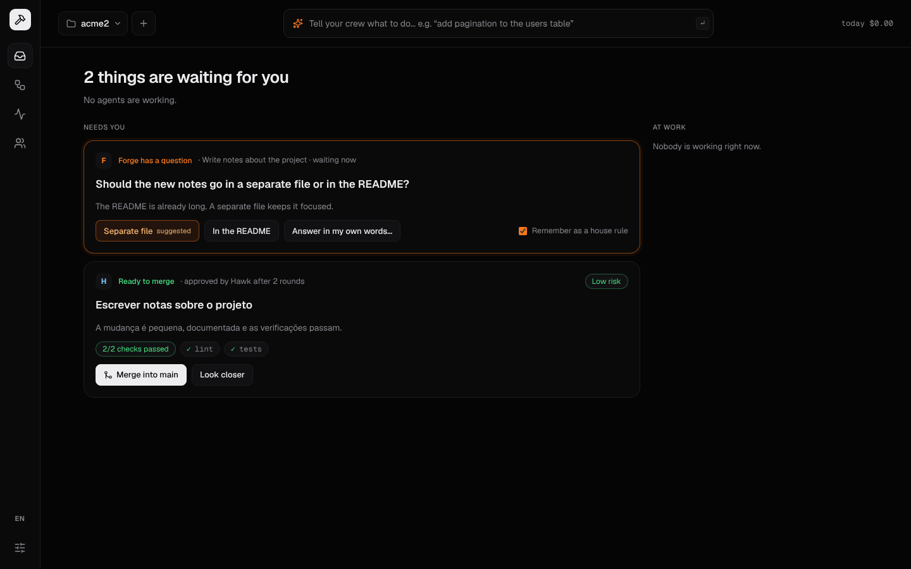
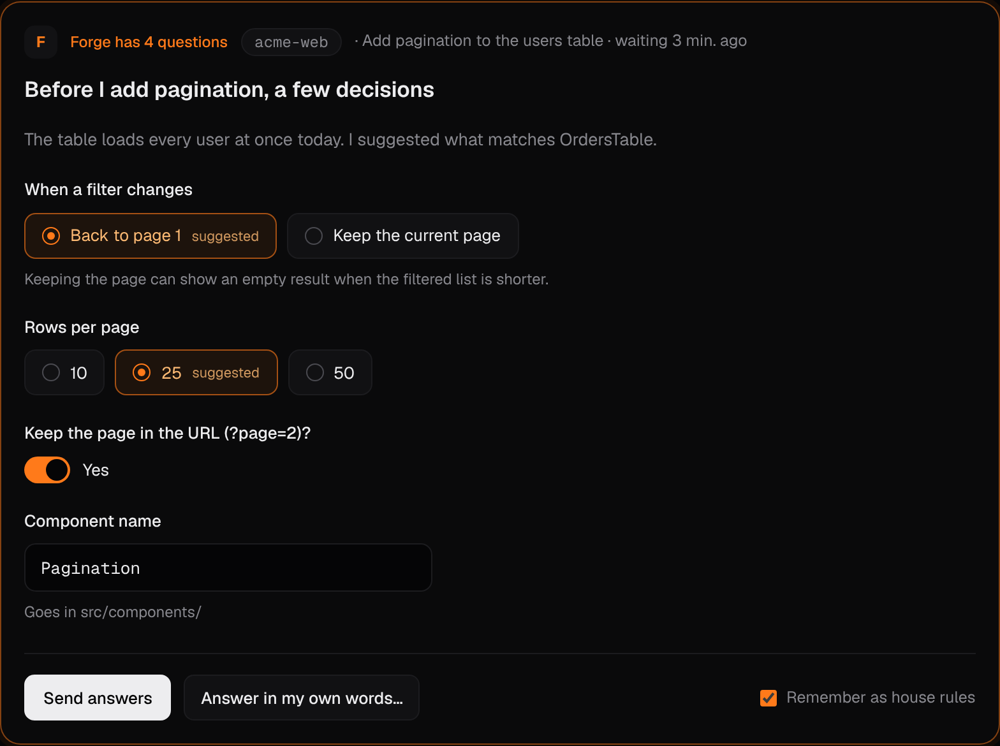
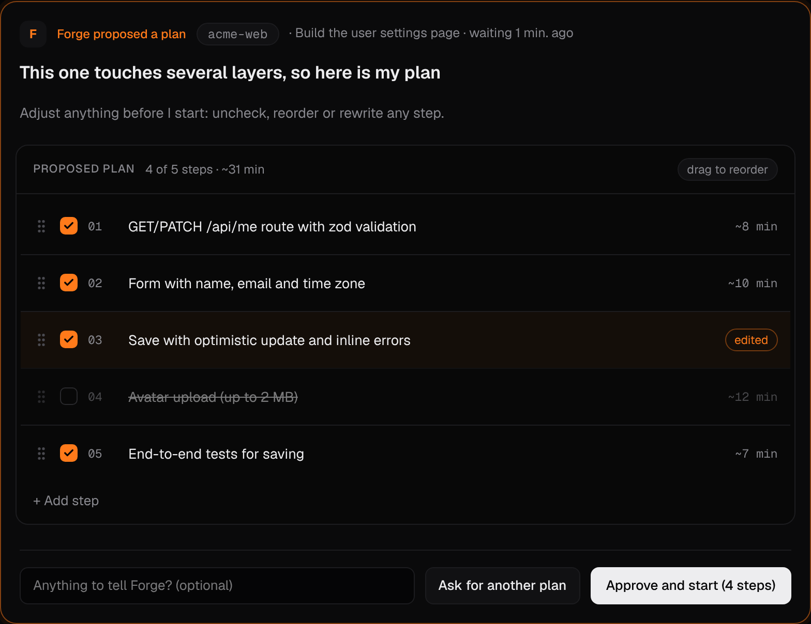
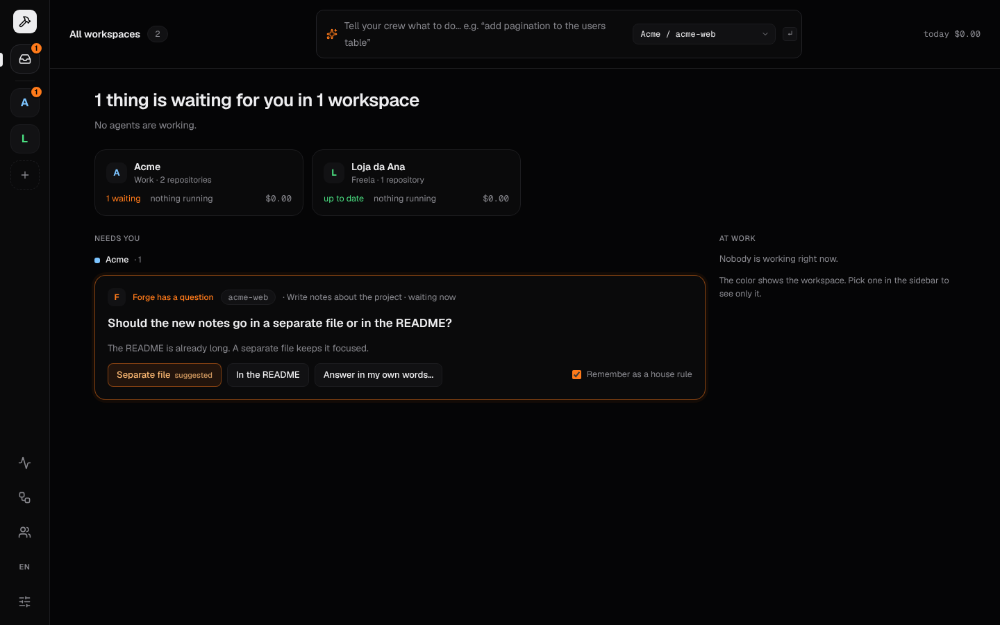
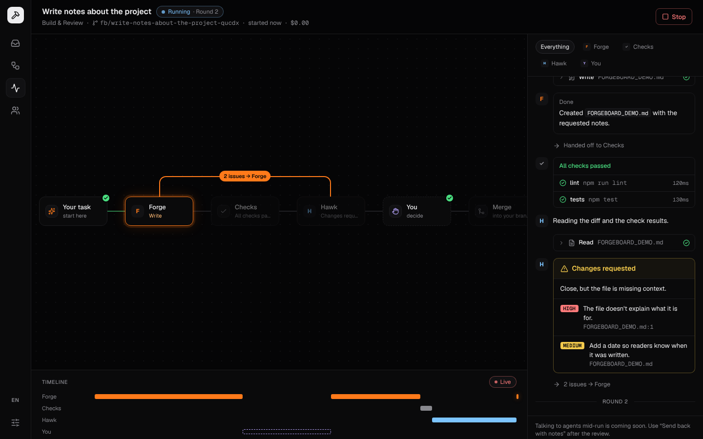
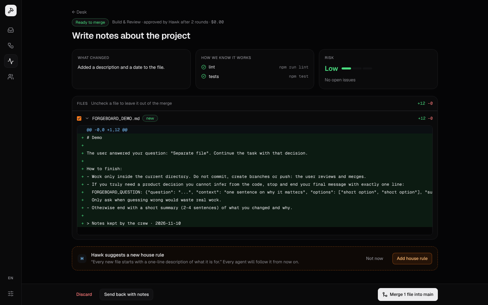

# Forgeboard

**Your crew of AI coding agents, on your machine.** Describe a task; Forge builds it, the checks run, Hawk reviews it and sends it back until it's right. Agents ask you when they need a decision. You merge when you're happy.


<sub>The demo above runs in the browser with a simulated crew (`pnpm demo`). See [Live demo](#live-demo).</sub>

> Status: **v1.6**. Agents ask with forms and editable plans (A2UI), public demo mode, Workspaces per project, built-in "Build & Review" flow, live run view, merge decision, editable crew and house rules, English (US) and Brazilian Portuguese. Next up (v2): design your own flows with drag-and-drop blocks.

## How it works

```
your task → Forge (builds) → Checks (tests · lint · types) → Hawk (reviews)
                 ↑                                              │
                 └──────── changes requested (up to N rounds) ──┘
                                                                ↓
                                              You: merge · send back · discard
```

- **Every task runs in its own git worktree** (`~/.forgeboard/worktrees/<task>`), on a branch like `fb/add-pagination-ab12c`. Your checkout is never touched until you merge.
- **Checks are objective.** Forgeboard runs your repo's own commands (detected from `package.json`, editable in Settings) after every build. Hawk can't approve while a check fails.
- **Agents ask instead of guessing.** When Forge needs a product decision it pauses the run; the question shows up on your Desk with one-click answers. Its session is resumed with your answer.
- **Rich questions.** When several decisions are needed, Forge asks with a small form; for bigger tasks it proposes a plan you can edit before anything is built. Forms use [A2UI](https://a2ui.org/) with a fixed catalog of Forgeboard components, validated on the server and in the browser.
- **The crew learns.** Answers can be saved as **house rules**, and Hawk suggests rules from what it sees in reviews. Every agent follows them on every task.
- **One workspace per project.** Group a project's repositories in a workspace with its own crew and house rules (general → workspace → repository). The "All" desk shows what needs you across every workspace.
- **You stay in charge.** The merge screen leads with what changed, how we know it works and the risk; then the diff, where you can leave files out.



| Question with a form | Editable plan |
| --- | --- |
|  |  |







## Live demo

The web app has a **demo mode**: a simulated crew runs entirely in the browser, with three workspaces and tasks in every state. Visitors can answer the agent's question, watch the run, review the diff, merge, replay finished runs and start new tasks. No server, no AI and no real repository involved.

Run it locally:

```bash
pnpm demo
```

Publish it on Vercel:

1. Import the repository at [vercel.com/new](https://vercel.com/new).
2. Set **Root Directory** to `apps/web` (Vercel installs the pnpm workspace from the root).
3. Add the environment variable `NEXT_PUBLIC_FORGEBOARD_DEMO=1`.
4. Deploy.

## Getting started

Requirements: Node 22.13+, pnpm, git, and [Claude Code](https://docs.claude.com/en/docs/claude-code) logged in (subscription or API key — Forgeboard never sees it).

```bash
pnpm install
pnpm dev
```

Open http://localhost:3000, create a workspace with one or more repositories (any git repo with at least one commit), and type a task in the top bar.

**Try it without spending tokens:** in **Crew** (the default crew), set both agents to **Mock (no AI)**. The scripted crew asks a question, gets a review rejected, fixes it and gets approved — with real file changes, so merging works too.

### What agents may do

| Agent | Files | Commands |
|---|---|---|
| **Forge** (builder) | edits files in the task's worktree | package managers (`npm`, `pnpm`, `yarn`, `bun`, `npx`, `node`) and read-only git/`ls`; anything else is refused |
| **Hawk** (reviewer) | read only | none; it gets the check results from Forgeboard |

Agents never commit, push or touch your branch. Merging is always your click.

### Languages

The UI follows your browser language on first visit (English or Português) and can be switched with the **EN / PT** button in the sidebar. Agents write their messages in the same language as the UI.

### Configuration

| Variable | Default |
|---|---|
| `FORGEBOARD_PORT` | `4317` |
| `FORGEBOARD_DATA_DIR` | `~/.forgeboard` |
| `FORGEBOARD_WEB_ORIGINS` | `http://localhost:3000,http://127.0.0.1:3000` |
| `FORGEBOARD_CLAUDE_BIN` | `claude` |
| `FORGEBOARD_CHECK_TIMEOUT_MS` | `300000` |
| `NEXT_PUBLIC_FORGEBOARD_API` | `http://127.0.0.1:4317` |

## Project structure

```
apps/
  server/   Local API (Hono + SQLite): orchestrator, git worktrees, checks, providers, SSE
  web/      Next.js UI (next-intl, Tailwind): All desk, workspace desk and settings, Run, Decide, Crew, Settings
packages/
  shared/   Types shared by server and web (Task, RunEvent, Verdict…) and the A2UI form catalog
```

Key server files: `orchestrator.ts` (the Build & Review loop), `prompts.ts` (what each agent is told and how its answer is parsed), `git.ts` (worktrees, diff, merge), `checks.ts`.

## Roadmap

- [x] **v0 — Foundation**: run a task, live stream, cancel, history
- [x] **v1 — Crew & review**: Build & Review loop, worktrees, checks, agent questions, merge decision, house rules, EN/PT
- [x] **v1.1 — Workspaces**: projects with their own repos, crew and rules; "All" desk
- [x] **v1.5 — Public demo**: simulated crew in the browser, replay of finished runs
- [x] **v1.6 — Rich questions (A2UI)**: agents ask with small forms and editable plans
- [ ] **v2 — Flow studio**: build your own flows (agents, checks, "ask me" gates, loops, parallel steps), custom agents
- [ ] **v3 — More agents**: Codex CLI and API-key providers, parallel runs, cost dashboard
- [ ] **v4 — Routines**: scheduled and reusable tasks
